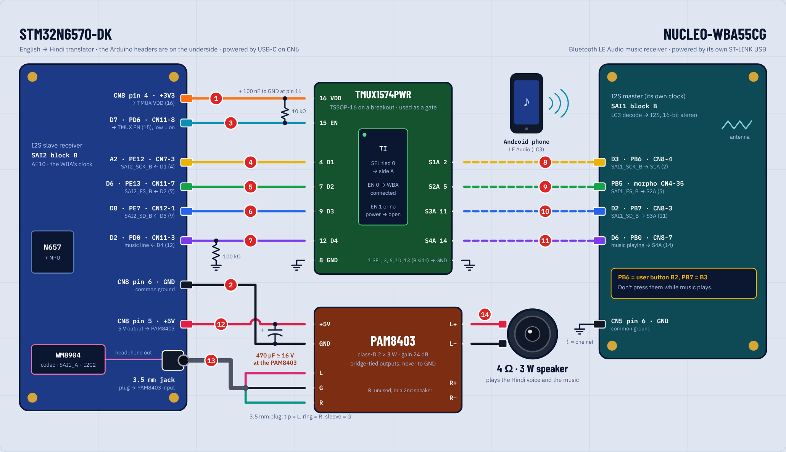

# Translator mode

Build with `-DAPP_TRANSLATOR_MODE=ON`. In this mode the STM32N6570-DK recognizes English and shows
the Hindi translation. It speaks through a MAX98357A amplifier and an 8 Ω 0.5 W speaker, which it
shares with a NUCLEO-WBA55CG Bluetooth LE Audio music receiver through a TMUX1574 switch. While
music plays, the music has the speaker and the N6 sleeps. Everything runs from the boards' USB
cables: no battery or separate supply.

## Wiring

[wiring.html](wiring.html) draws the whole setup with the connections in wiring order; open it in
a browser. The same as images: [wiring_schematic.png](wiring_schematic.png) (the drawing) and
[wiring_full.png](wiring_full.png) (the drawing, the numbered steps and the notes).



All pins were checked against UM3300 (DK), UM3301 (Nucleo), the TMUX1574 data sheet, the CubeMX pin
database, and ST's own WBA LE Audio example, which uses SAI1 on PB6, PB5 and PB7.

**Power**

- MAX98357A VIN: DK CN8-5, the board's +5 V output. The speaker adds at most about 0.1 A.
  Optionally, put 100 µF across VIN and GND at the amplifier.
- DK power: USB-C on CN6 (ST-LINK), from a USB-C port or charger. UM3300 says the board then gets
  up to 1.66 or 3.2 A. An old USB-A port can limit it to 0.55 A.
- Nucleo power: its own ST-LINK USB cable.
- GND: one common ground for the DK (CN8-6), the Nucleo (CN5-6), the TMUX (pin 8) and the
  amplifier.
- TMUX1574 VDD (pin 16): DK CN8-4 (+3.3 V), with 100 nF to pin 8 right at the chip.

**TMUX1574PWR (TSSOP-16).** Side A is the WBA. It is also the hardware default (SEL pulled down),
so music plays while the N6 sleeps. Side B is the N6.

| Pin | Name | Connect to |
|---|---|---|
| 1 | SEL | DK D7 = PD6 (CN11-8), and 100 kΩ to GND |
| 2 | S1A | Nucleo PB6 (CN8-4, "D3"): WBA bit clock |
| 3 | S1B | DK A2 = PE12 (CN7-3): N6 bit clock |
| 4 | D1 | MAX98357A BCLK |
| 5 | S2A | Nucleo PB5 (morpho CN4-35): WBA left/right clock |
| 6 | S2B | DK D6 = PE13 (CN11-7) |
| 7 | D2 | MAX98357A LRC |
| 8 | GND | ground |
| 9 | D3 | MAX98357A DIN |
| 10 | S3B | DK D8 = PE7 (CN12-1) |
| 11 | S3A | Nucleo PB7 (CN8-3, "D2"): WBA data |
| 12-14 | D4, S4B, S4A | GND |
| 15 | EN | GND |
| 16 | VDD | +3.3 V |

**MAX98357A**

- GAIN: 100 kΩ from GAIN to VIN, which sets 3 dB. This resistor is required for the 0.5 W speaker.
  - At 3 dB, a full-scale sine is 2.1 dBV + 3 dB = 1.8 Vrms, or 0.40 W into 8 Ω.
  - The firmware also lowers its own output by 3 dB (`XL_AUDIO_OUT_CEILING_Q15`), so even a
    full-scale square wave stays at 0.40 W.
  - With GAIN left open (9 dB), the same sine would be 1.6 W.
- Speaker: 8 Ω 0.5 W, across the two output terminals only.
- SD: first measure it with nothing connected and the module powered.
  - About 0.4-0.5 V: the module has its own 1 MΩ pull-up, so it plays the (L+R)/2 mix.
  - About 0 V: add 1 MΩ from VIN to SD.
- Then connect DK D4 = PH5 (CN11-5) through 1 kΩ to SD. The firmware drives PH5 open-drain: low
  mutes the amplifier for about 40 ms around each source switch.

The SD voltage selects the channel: below 0.16 V shutdown, 0.16-0.77 V (L+R)/2, 0.77-1.4 V right,
above 1.4 V left. For stereo, use two amplifiers on the same three I2S lines, one set to left and
one to right, each with its own 8 Ω speaker and GAIN resistor. Both can run from the DK's 5 V.

The WBA has no level cap yet. When its firmware is ported, cap its volume the same way. Until then,
the 3 dB GAIN setting is what keeps music within the speaker's rating.

**Music line.** Nucleo PB0 (CN8-7, "D6") goes to DK D2 = PD0 (CN11-3), with 100 kΩ to GND on the DK
side. The WBA holds it high while music plays.

Not used, and why:

- PD12 is the DK's Ethernet MDIO line.
- PA8 is the Nucleo's ST-LINK VCP RX line.
- The Nucleo user buttons B2 and B3 sit on PB6 and PB7: do not press them while music plays.

## Behavior

- **Translation.** The recognized English is cut into sentences (`xl_sentence.c`): at a `.`, `?` or
  `!`, after 1.2 s with no new words, or at 200 characters. Each sentence is translated on the
  board (`src/translate/it2.c`, about 2 to 4 s per sentence, to be measured) and the Hindi appears
  under the last two lines of English. The status bar says "Translating..." meanwhile.
- **Speech.** If the N6 has the speaker, the Hindi is then spoken (`xl_speech.c`): "Speaking
  Hindi..." in the status bar. Recognition pauses while it speaks, so it does not hear itself, and
  sentences said meanwhile are not recognized.
- **Speaker.** AUTO mode (the default) gives the speaker to the music while it plays, and to the
  translator otherwise. TRANSLATE and MUSIC force one source. The USER button cycles through the
  three modes.
- **Music always wins.** When music takes the speaker, speech stops at once (the speaker stream is
  flushed and stopped), a translation in progress is cancelled within one word, and the queued
  sentences and the half-heard one are dropped.
- **Sleep.** While the music has the speaker, the N6 sleeps:
  - recognition is paused, so the NPU is idle;
  - the translator thread waits, idle;
  - the speaker stream is stopped;
  - the screen and backlight go off 5 s later;
  - the CPU waits in WFI.

  A tap or the USER button lights the screen for 10 s. When the music stops (1.5 s without the
  line), or on TRANSLATE, the N6 wakes and beeps twice.
- **TONE** plays 880 Hz on the speaker, to check the wiring.

## Models and memory

`models.json` is the memory map: every model's slot in the 128 MB NOR flash and the PSRAM
regions. `tools/models_layout.py` checks it and writes `xl_models.h`; `tools/flash.py n6 --models`
programs the blobs. Without a blob the firmware still runs: no translation model, a message on the
screen; no font, a message; no voice networks or front-end weights, text only. The log on the
ST-LINK serial port (115200 baud) says which.

| Blob | Made by | Runs on |
|---|---|---|
| Translation (IndicTrans2, 4-bit) | `model-tools/it2_pack.py` | CPU |
| Hindi font | `model-tools/assets/hi_font_40.bin` | CPU |
| Voice front end (MMS-TTS text encoder, durations) | `model-tools/tts_front_pack.py` | CPU |
| Voice flow, vocoder | ST Edge AI from `tts_eval.py` / `tts_export.py` graphs | NPU |
| Speech recognition | `src/asr_engine/models/cynipsnet_punct1` | NPU |

## Test without the WBA

Connect a jumper from DK D2 (CN11-3) to +3.3 V (CN8-4). The router sees music playing, gives the
speaker to side A and puts the N6 to sleep. Remove the jumper: about 1.5 s later the N6 wakes and
beeps. With the jumper in while the N6 speaks, the speech must stop at once.

## PC tests

From this folder (gcc or clang):

```
cc -I. xl_sentence.c test/sentence_host.c -o sentence_host && ./sentence_host
cc -DXL_SPEECH_HOST_TEST -I. -I../../tts xl_speech.c xl_resample.c ../../tts/tts_front.c test/speech_host.c -lm -o speech_host
./speech_host ../../../../model-tools/out/tts/tts_front.bin
cc -DXL_HINDI_TEXT_HOST_TEST -I. xl_hindi_text.c test/hindi_text_host.c -o hindi_text_host
```

## Not done yet

- Measured speed on the board (translation, voice), and the first test with the wiring.
- True Stop mode: the microphone driver cannot restart, so "sleep" is currently idle plus WFI.
